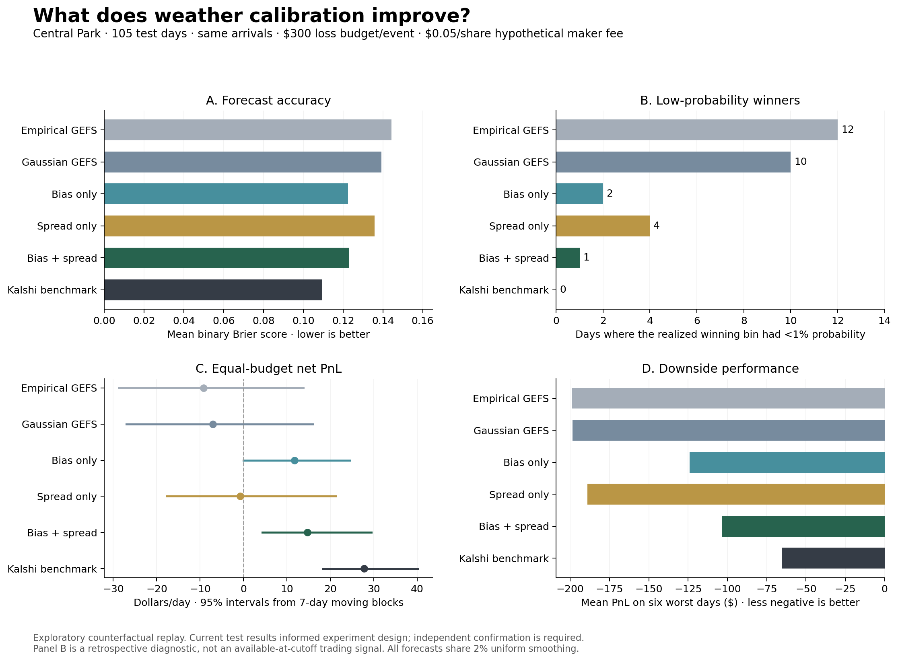

# Jessie's controlled calibration experiment

## Question and scope

Does correcting the average temperature forecast or correcting its uncertainty matter more for forecast scores and market-making losses?

This extends the team's current rolling calibration and LMSR replay without replacing any of their existing files or reports. It uses the existing NYC/Central Park year, with **105 test days from May 1 through August 13, 2026**, and exports forecasts for 350 days after calibration warm-up. All comparisons use the same dates and six contracts per event.

**These are exploratory results.** The existing test period was already examined before choosing this experiment. An additional period or city, with the method frozen before inspecting its outcomes, is required for confirmation. A counterfactual replay does not establish realizable trading profits.

## Controlled forecast variants

| Variant | Mean | Standard deviation / distribution |
| --- | --- | --- |
| `empirical_smoothed` | Empirical member distribution | Count members in each bin, then apply the common probability mixture |
| `gaussian_uncorrected` | Today's ensemble mean | Today's ensemble standard deviation, floored at 1.5°F |
| `bias_only` | Ensemble mean + recent mean observed-minus-forecast error | Same SD as the uncorrected Gaussian |
| `spread_only` | Same mean as the uncorrected Gaussian | Centered residual dispersion, scaled by today's ensemble variance |
| `bias_and_spread` | Same corrected mean as `bias_only` | Same corrected SD as `spread_only` |

The four Gaussian variants form a 2×2 experiment. This isolates mean and spread changes. Comparing the empirical variant with the uncorrected Gaussian identifies the effect of distribution shape and its minimum-SD constraint.

All five variants use the **same 2% uniform probability mixture**. This differs intentionally from the existing `ensemble_smoothed` replay seed, which uses additive half-count smoothing. New comparisons should use the new controlled exports rather than mixing definitions across experiments.

The spread fit centers historical errors around their mean **even when that mean correction is not applied to today's prediction**. This keeps average bias from being counted again as dispersion in the spread-only variant. For the selected `scaled` method:

```text
bias = mean(observed high - ensemble mean) over eligible recent days
residual_sd = standard deviation of errors after subtracting that bias
corrected_sd = residual_sd * sqrt(0.5 + 0.5 * today's ensemble variance / recent mean ensemble variance)
```

The corrected SD is also floored at 1.5°F. Probabilities integrate each Gaussian over the half-degree boundaries implied by the whole-degree contract bins, then apply the common mixture.

## Training and availability controls

- Candidate windows: 14, 21, 30, 45, 60, and 90 calendar days; spread rules: `errors` and `scaled`.
- The fully corrected Gaussian's training log loss selects **one shared window and spread rule** for every variant. This is a controlled ablation, not a claim that every variant is independently optimized.
- Selection uses 242 identical training days, September 1, 2025–April 30, 2026. The selected settings are **30 days, scaled spread**.
- At each prediction date D, rolling coefficients use verified observations through **D-2**. D-1 is not complete at the previous-day noon forecast cutoff.
- During the test period, the fixed algorithm can learn from *earlier, already available* test-period observations. Hyperparameters remain fixed; this is sequential forecasting rather than a frozen coefficient fit.
- All variants share the warm-up eligibility mask; none receives an easier subset of test dates.
- Every exported row identifies its prediction time, probability, variant, Gaussian or empirical parameters, observation count, and latest calibration observation. Input files are fingerprinted in the manifests.

## Equal-risk replay

`ablation_replay.py` passes the exported forecasts into the existing `backtest.replay_day` function. Every model faces the same observed taker arrivals and target-day noon quoting halt. It adds the smoothed Kalshi opening distribution as a benchmark.

Two modes are reported:

1. **Equal opening loss budget:** $300 per event, with `b = 300 / log(1 / minimum opening probability)` computed separately for each day and forecast. Every opening forecast therefore has the same theoretical pre-fee worst-case loss bound.
2. **Fixed b:** 300 for all forecasts. This reproduces the existing common-b comparison but allows different loss bounds.

The main fee is **$0.05/share**, reused from the team's existing train-selected calibrated-NOAA configuration and held constant across every model. A separate zero-fee replay is included. The fee is a hypothetical maker charge, not an estimate of Kalshi's exchange fee schedule. The $300 budget is illustrative and was not optimized on these results. Results across the two risk modes should not be compared as if they used the same capital.

The replay checks realized pre-fee trading PnL against each opening theoretical loss bound. Equal bounds do not guarantee equal turnover, inventory, or realized risk.

## Results and interpretation

| Forecast | Brier | Binary log loss | Winning-bin probability below 1%: days | Equal-budget mean net PnL/day | Mean PnL on six worst days |
| --- | ---: | ---: | ---: | ---: | ---: |
| Empirical GEFS with common smoothing | 0.1443 | 0.5002 | 12 | -$9.18 | -$199.00 |
| Uncorrected Gaussian | 0.1392 | 0.4823 | 10 | -$7.04 | -$198.56 |
| Bias only | 0.1224 | 0.3977 | 2 | $11.75 | -$124.00 |
| Spread only | 0.1358 | 0.4558 | 4 | -$0.80 | -$189.15 |
| Bias + spread | 0.1229 | 0.3917 | 1 | $14.75 | -$103.46 |
| Smoothed Kalshi benchmark | 0.1094 | — | 0 | $27.79 | -$65.35 |

Forecast scores are binary-contract averages. The Kalshi Brier shown here uses the common smoothed, normalized opening vector, so it differs slightly from the team's unsmoothed-midpoint comparison. The table's economic columns use the $300 loss budget and $0.05/share hypothetical fee, not the older fixed-b table.

The results suggest:

- **Bias correction drives most of the average Brier improvement.** Bias-only has the lowest NOAA Brier point estimate, but it is not clearly distinguishable from bias-plus-spread.
- **Spread correction improves probability assigned to missed outcomes descriptively.** With both corrections, one winning outcome receives under 1% probability, versus ten for the uncorrected Gaussian and two for bias-only. This counts realized winners retrospectively; it is not an available-at-cutoff trading signal.
- **Fully corrected forecasts improve replay PnL versus the uncorrected Gaussian under the specified equal-budget assumptions.** The mean paired gain is $21.79/day; its 95% seven-day moving-block interval is $1.74–$42.15.
- **The incremental economic benefit of adding spread correction to bias correction is uncertain.** Its mean paired net-PnL gain is $3.00/day, with a weekly-block interval of -$0.59–$9.07. The six-day downside average is descriptive, with no claim of a significant tail-risk difference.
- **Kalshi remains the stronger benchmark.** The fully corrected NOAA maker earns $13.03/day less than the Kalshi-seeded maker on average, with a weekly-block paired interval of -$22.75 to -$2.87.
- **Fees remain central.** For fully corrected NOAA at equal budget, mean trading PnL is -$56.30/day and hypothetical fee income is $71.05/day. Net positive replay PnL should not be presented as forecast-based arbitrage.

All intervals are exploratory and not adjusted for testing multiple comparisons. Each interval resamples complete days, and seven-day moving blocks provide sensitivity to serial weather dependence. The weekly blocks do not wrap the final study date back to the first.



## Run

```bash
.venv/bin/python calibration_ablation.py
.venv/bin/python ablation_replay.py
.venv/bin/python plot_calibration_ablation.py
.venv/bin/python -m unittest discover -v
```

No new API downloads are required. The committed extracted forecasts and compressed trade flow are sufficient. For sensitivity runs, `ablation_replay.py --budget 100` changes the common loss budget; it overwrites the experiment's replay outputs, so preserve the existing output directory first if comparing budgets.

Primary files in `data/results/calibration_ablation/`:

- `probabilities.csv`: model probabilities for all eligible contracts and dates, with provenance.
- `daily_scores.csv`, `forecast_scores.csv`, `paired_differences.csv`: forecast scores and day/weekly-block uncertainty.
- `replay_daily.csv`, `replay_summary.csv`, `replay_paired_differences.csv`: economic results with fees and risk controls.
- `winner_probability_diagnostics.csv`: retrospective missed-outcome diagnostics.
- `report.md`, `replay_report.md`: generated tables.
- `manifest.json`, `replay_manifest.json`: frozen settings and input checksums.
- `experiment_overview.png` and `.svg`: standalone research figure.

Next confirmation should use frozen settings on another time period or an independently held-out city. The current results do not establish a novel finding across weather markets generally.
