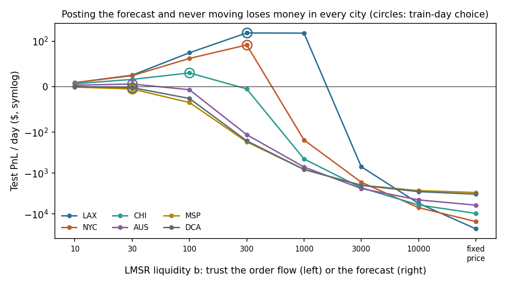
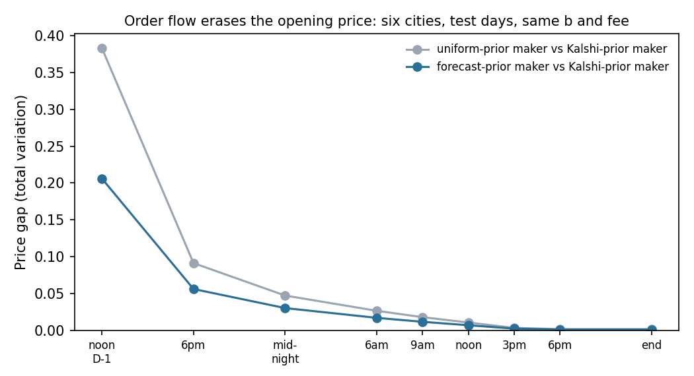
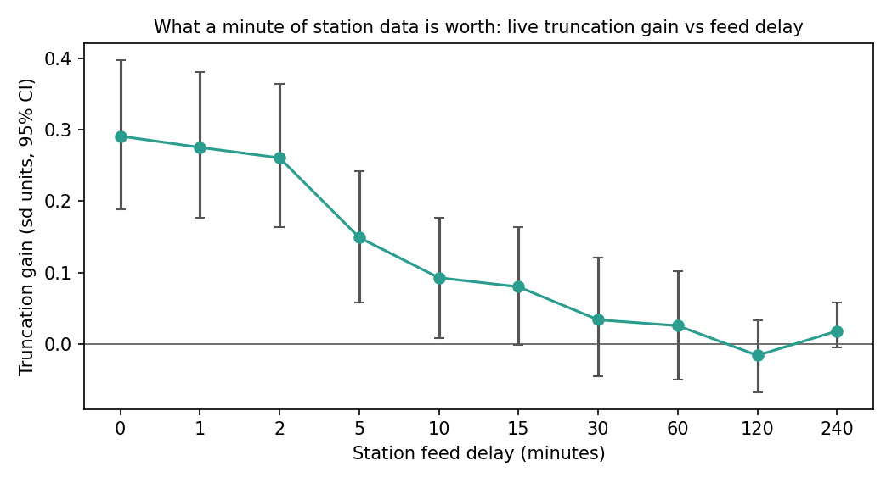

# What Makes a Weather Market Maker Domain-Specific?

*Forecasting, market efficiency and market making for Kalshi's daily high-temperature contracts*

ECE 473 project, track 1a (domain-specialised market makers). Every number here is generated by the code in this repository; section headers name the module and results file behind each claim. `python run_pipeline.py` reproduces all of it from the data on disk.

---

## Abstract

We build a domain-specialised market maker for Kalshi's daily high-temperature markets and test it against general-purpose and forecast-only baselines on real order flow. A domain forecasting model (a walk-forward random forest over ECMWF, the National Blend of Models, NWS MOS and station observations) beats climatology, the raw GEFS ensemble and a calibrated GEFS model, but not the Kalshi price itself (test Brier 0.113 vs 0.109). An event study across 15 cities shows why: public forecast information is mostly in the price before it is published. A maker therefore cannot simply post its forecast as the price: in replay, a fixed-price quoter loses $3,000–$23,000 a day in every city tested. The maker has three sources of information, and each needs its own mechanism: the forecast sets the opening price; the order flow, through the LMSR, corrects it (within about 12 hours, makers opened at a uniform, forecast or crowd price quote the same prices); and the settlement rules tell the maker what traders would otherwise have to teach it at a loss. **Our thesis is that a weather market maker's domain advantage comes less from forecasting the weather than from knowing how the outcome is decided.** The daily high is a running maximum of one named station, so live observations rule outcomes out permanently. Truncating prices on the live station maximum pays in all six cities. The gain halves when the station feed is 5 minutes old and is gone within about 30 minutes. It has a provable cost in worst-case loss, but that bound assumes the station reading matches the official record. The data broke that assumption twice (a 2°F rounding gap in New York, a 120°F sensor spike in Los Angeles). A training-only safety margin repairs the first failure, improves on the forecast-only maker in every city where it is active, and exposes the second failure as a limitation of the rule.

---

## 1. Introduction

Prediction markets list contracts on politics, sports, crypto and weather, but their market makers mostly use the same mechanism everywhere: a logarithmic market scoring rule (LMSR) or an order book seeded by a generic prior. The project asks what a maker gains from knowing its domain.

We study Kalshi's `KXHIGH*` markets: each day, six mutually exclusive contracts on the official high temperature at one station (for example "90–91°F at Central Park"). Weather looks like an easy domain for a specialist, because forecasts are public, physical and well studied. That turns out to be the problem. Anyone can look up the forecast, so a better forecast alone is a weak edge. What a general-purpose maker cannot know is the *structure* of the settlement and the information flow:

1. **Settlement is a running maximum.** The high can only rise during the day. Once the station passes 92°F, every bin below 92 is dead, permanently. Sports scores and elections do not cut the outcome space down like this minute by minute.
2. **One known station, known rules.** The NWS Climatological Report defines the day as midnight to midnight local *standard* time and rounds between °C and °F. The 1-minute sensor reads 1°F above the official high on many days.
3. **A scheduled information calendar.** Model runs and hourly reports arrive at known times.
4. **Physical forecast structure.** Station bias, ensemble spread and local effects (the afternoon sea breeze is the most important single feature in our model).

A natural objection to building a market maker on a forecast is that if the forecast were the true probability, it should simply *be* the price, with no need for an LMSR. Section 6.2 tests that idea directly and finds that it fails badly. The forecast is the right *opening* price, but the maker must keep learning: from traders, through the LMSR, and from the station, through its knowledge of how the contract settles.

**Contributions.**
- A leakage-controlled forecasting pipeline and a domain model that beats every generic and single-source baseline (Section 4).
- Five hypotheses about how the market works, each tested on real data: who trades and wins, whether forecasts are priced in, how fast observations are priced, and whether liquidity makes prices smarter (Section 5).
- Evidence for why a forecast-driven maker needs an LMSR rather than a posted price, and how much it should trust each (Section 6.2).
- A domain market maker whose key mechanism, live running-maximum truncation, improves PnL in all six cities tested, with a measured value of feed speed (Sections 6.4–6.5).
- A worst-case loss bound for that mechanism, two real-data failures of the bound's assumption, and a training-only repair tested across five cities (Sections 6.6–6.7).

---

## 2. The domain

### 2.1 Contracts

Each event has six bins: two open tails and four 2°F "between" bins, set the day before. A bin pays $1 if the official high falls in it. Markets open around 10am ET the day before and close after the day ends. From Aug 14, 2026 every series switched settlement source to The Weather Company, so each study window ends Aug 13, 2026 and every contract in it names the NWS Climatological Report.

### 2.2 Information sources and timing

| Source | What | Public when | Used for |
|---|---|---|---|
| GEFS ensemble (NOAA) | 31-member global ensemble | ~5 h after cycle | Raw and calibrated NOAA forecast |
| ECMWF IFS | European global model | ~8 h after cycle | ML feature |
| NBM (NWS) | Statistical blend of many models, max-temperature forecast and spread | ~1 h after cycle, hourly runs | ML feature; public forecast in Section 5 |
| GFS / NAM MOS (NWS) | Station-specific statistical forecasts | ~4 h after cycle | ML feature; public forecast |
| ASOS hourly report | Station observation at :51 | Minutes later | Observations so far |
| ASOS 1-minute record | The sensor itself | 5-minute public feed | Latency study, live maker |

### 2.3 What a general-purpose maker would do

A fixed-liquidity LMSR with a uniform prior (or a copy of the market's own price), no weather data and no knowledge of settlement. It is our strawman (`generic`, Section 6).

---

## 3. Data and backtest design

| Dataset | Coverage | Module |
|---|---|---|
| NYC contracts, GEFS, noon quotes | Aug 14, 2025 – Aug 13, 2026, 365 days | `collect.nyc` |
| NYC taker trades and hourly candles | Same, 2.53M trades | `collect.trades` |
| ECMWF, NBM, GFS/NAM MOS, ASOS (NYC) | Mar 2024 – Aug 2026, 895 days | `collect.features` |
| 15 cities: hourly quotes, every NBM/GFS MOS run, ASOS | Apr 1 – Aug 13, 2026, 2,024 city-days | `collect.city_markets` |
| 6 cities: 1-minute ASOS, every trade | Same window, ~4.9M trades | `collect.realtime` |

**Leakage controls.** Every forecast is made at noon local time the day before (the *cutoff*), using only information public by then: model runs must be old enough to have been published, and observations stop at the cutoff. Anything fit to verified outcomes uses days up to D-2 only, because the D-1 high is not final at the cutoff. The ML model is refit weekly by walk-forward, so its forecasts are out of sample on every day, train or test.

**Splits.** NYC forecasting and the NYC LMSR backtest: train Aug 14, 2025 – Apr 30, 2026, test May 1 – Aug 13, 2026 (105 days). Six-city market making: train Apr 1 – May 31, test Jun 1 – Aug 13, 2026. All model and maker settings are chosen on train days only.

**Inference.** 95% intervals resample whole days (city-days when pooled), because the six contracts of a day are not independent.

**Station validation.** For every city the settled high is checked against the station's own ASOS maximum: within 1°F on 76–96% of days (`data/cities/*/validation.json`).

---

## 4. Forecasting (Part I)

*Modules: `forecast.*`, `analysis.evaluate`, `analysis.compare_forecasts`, `analysis.ml_compare`. Results: `data/results/ml/ml_tables.md`.*

### 4.1 Models, from generic to domain-specific

| Model | Domain knowledge used |
|---|---|
| Climatology | 1991–2020 station highs for the date |
| Persistence | High from two days earlier |
| Raw GEFS | One global ensemble, nearest grid point |
| Calibrated NOAA | GEFS plus a rolling 30-day station bias and spread correction |
| Forecast consensus | Mean of ECMWF, NBM, GFS MOS, NAM MOS, with fitted spread |
| ML random forest | 45 features: the four forecasts, their disagreement and recent errors, afternoon wind, cloud, dewpoint, station observations at the cutoff, season |

The forest predicts the *correction* to the consensus, not the raw temperature, and a second fit sets each day's spread. Gaussian bins turn the mean and spread into six probabilities.

### 4.2 Results (NYC, 105 test days, 630 contracts)

| Model | Brier [95% CI] | Log loss |
|---|---|---|
| Climatology | 0.1685 [0.1533, 0.1823] | 0.559 |
| Raw GEFS | 0.1450 [0.1337, 0.1569] | 0.656 |
| Calibrated NOAA | 0.1229 [0.1143, 0.1318] | 0.392 |
| Forecast consensus | 0.1154 [0.1083, 0.1226] | 0.367 |
| **ML random forest** | **0.1129 [0.1052, 0.1206]** | **0.356** |
| Kalshi noon midpoint | 0.1091 [0.1010, 0.1172] | 0.341 |
| Kalshi + ML blend (fit on train) | 0.1074 [0.0985, 0.1167] | 0.332 |

- The domain model beats calibrated NOAA by 0.010 Brier [−0.019, −0.001].
- It does not beat Kalshi (0.004 worse, interval includes 0 on test; significantly worse on train days).
- Combining sources is what matters. Any single source alone scores test log loss 0.378–0.387, versus 0.356 for all of them; the plain consensus gets most of the way.
- Most valuable inputs: NBM, season, and recent forecast errors (ablation). The most important single feature is the afternoon east–west wind (sea breeze versus offshore flow).
- Blended with Kalshi, the forest still carries weight (0.39 in log-odds, beside Kalshi's 0.94) and improves log loss by 0.009 [0.003, 0.015]. The noon price misses some of the domain information, but not much.

**Model choice caveat.** The forest was picked after comparing four learners. The rule we set in advance (lowest train log loss) picked ridge regression, which then overfit the summer test period. `docs/DATA_NOTES.md` records this; train-day results do not depend on it.

---

## 5. How the market functions (Part II)

The forecasting results raise a question that matters to any maker: what does the crowd know, and when? Each subsection below states a hypothesis a market maker would care about and tests it on data.

### 5.1 H1: Some traders are systematically uninformed, and a forecast can identify them

*Module: `analysis.trader_behavior`. Results: `data/results/traders/trader_tables.md`. NYC, 2.53M taker trades, $28.6M of premium.*

**Supported.**
- **Timing.** 89% of contracts trade on the target day itself; 1% before the noon cutoff the day before.
- **Optimism bias.** YES takers lose 1.6¢ per contract before fees; NO takers break even (+0.6¢).
- **Longshot bias.** Contracts bought at 5–10¢ win 6.1% of the time.
- **Size.** Single-contract trades lose 2.5¢ per contract after fees. Trades over 1,000 contracts (26% of volume, mostly buying cheap contracts at about 9¢) roughly break even. These look like professionals.
- **The domain model sorts the flow.** Takers trading strongly *against* the ML forecast lose 3.2¢ per contract [−5.3, −1.0]; those it strongly agrees with earn +1.4¢. A maker that knows the forecast knows which fills are likely informed.

### 5.2 H2: Public forecasts move the price when they are published

*Module: `analysis.efficiency`. Results: `data/results/efficiency/efficiency_tables.md`. 15 cities, 2,024 city-days.*

The public forecast here is the bias-corrected mean of the latest NBM and GFS MOS runs. In NYC it scores close to the ML model (Brier 0.119 vs 0.116), so the cheaper forecast is used across cities.

**Rejected: the price moves before publication, and the crowd knows more than the forecast.**
- **Kalshi knows more than the public forecast.** At the noon cutoff it removes 27% of the public forecast's squared error, in every one of 15 cities. About 90% of each departure of the price from the public forecast turns out to be information (γ = 0.90 [0.79, 1.02]).
- **The edge peaks on the target-day morning** (47% of the squared error removed) and vanishes by mid-afternoon. By then a simple nowcast from the forecast plus observations so far matches Kalshi (RMSE 0.95 vs 0.99°F).
- **Forecasts are priced before release.** Around NBM releases the price has already moved 68% of the warranted amount *before* the archived run is out; the rest arrives slowly (39% by 8 hours). NBM runs hourly and its inputs are published earlier, so the "anticipation" mostly reflects information we could not archive, not private information. Less-watched GFS MOS is priced slowly (50% by 8 hours).
- **Observations are priced within about two hours** at hourly resolution: 82% of the warranted move by 2 hours, 96% by 8.

### 5.3 H3: The market waits for the official hourly report before pricing a bin as dead

*Module: `analysis.latency`. Results: `data/results/realtime/realtime_tables.md`. 6 cities, about 1,100–1,240 knock-outs.*

A *knock-out* is the minute the station's 1-minute running maximum passes a bin's upper edge. We measure two ways that bracket the truth: *first touch* (the reading reaches the edge; may round back down officially) and *certain* (1°F past the edge).

| | First touch | Certain |
|---|---|---|
| Bin priced dead before the crossing | 48% | 79% |
| Dead within 15 minutes | 65% | 91% |
| Still alive after an hour | 14% | 4% |

**Mostly rejected: the market runs on near-live data**, often extrapolating the warming trend before the bin is formally ruled out. Two refinements:
- **Traders trust the feed that predicts settlement.** In Los Angeles, where the 1-minute maximum equals the official high on only 20% of days, slow prices wait for the hourly report (slope 0.77). In Chicago, where it matches 70% of the time, they ignore it (slope about 0.1). Suggestive with 6 cities.
- **Stale prices still cost money.** In NYC $830–2,970 a day is paid for contracts that are already dead, versus $20–400 in thin cities; fast traders collect 40–74% of it.

### 5.4 H4: More liquid markets have more informative prices

**Rejected.** Across 15 cities, more volume buys **tighter spreads** (rank correlation −0.61) but **not more informative prices**. The correlations with Kalshi's edge (−0.42) and with γ (−0.49) are negative and not significant. The busiest market, Los Angeles, has the least informative price departures. Busy days are the uncertain-weather days, so volume is not an independent cause.

### 5.5 What this means for a market maker

The crowd beats the forecast (H2) and reacts to the station within minutes (H3), but some takers are reliably uninformed and the forecast can spot them (H1). A maker built on a forecast must therefore keep learning from traders after it opens, and the one place it can be faster than the crowd is the station itself. Section 6 builds a maker on those two facts.

---

## 6. Market making (Part III)

### 6.1 Mechanism and replay

Every maker is an LMSR over the six bins with liquidity *b* and a per-contract fee. The LMSR keeps track of the shares q it has sold and quotes prices pᵢ ∝ πᵢ·e^{qᵢ/b}: buying a bin raises its price, and *b* sets how far one trade moves it. The *prior* π is the maker's opening price; we seed q so that the opening price equals the prior exactly (`market/lmsr.py`).

Every real Kalshi taker trade after the noon cutoff becomes a limit order at the price that taker paid, and fills against the maker only while the maker is at least as good. This never gives a trader a worse deal than they really got, but it misses trades the maker would have attracted, and traders might have reacted to different quotes. All PnL is therefore a counterfactual estimate. Metrics: daily PnL with day-bootstrap intervals, worst and 5th-percentile day, worst-5% mean, share of profitable days, shares filled, PnL per share, opening and closing Brier, peak worst-case loss.

### 6.2 If the forecast is good, why not just post it?

*Module: `market.mechanism`. Results: `data/results/mechanism/mechanism_tables.md`. Six cities, test days, each city's train-day fee.*

If the forecast were the true probability, the best maker would post it as the price and never move, which is an LMSR with b → ∞. Section 5 already suggests otherwise: the crowd knows more than the forecast, so a maker that cannot update is trading against better-informed takers at stale prices. We test it directly by replaying the forecast-prior maker over a range of b, from 10 to a fixed-price quoter.



| b | LAX | NYC | CHI | AUS | MSP | DCA |
|---|---:|---:|---:|---:|---:|---:|
| 30 | $25 | $24 | $16 | $6 | −$5 | −$2 |
| 300 | $160 | $92 | −$5 | −$115 | −$172 | −$162 |
| 3,000 | −$699 | −$1,669 | −$2,283 | −$2,380 | −$1,974 | −$1,988 |
| Fixed price (post the forecast) | −$22,970 | −$15,245 | −$9,650 | −$6,053 | −$2,982 | −$3,274 |

*Mean test PnL per day, forecast prior, no live data.*

- **Posting the forecast loses money in every city**, by $3,000 to $23,000 a day. Informed takers buy every bin the forecast underprices and keep buying, because the price never responds.
- **How much to trust the forecast depends on the market.** In the busy markets (Los Angeles, New York) the best b is 300; in Chicago 100; in the thin markets 10–30, the bottom of the range. Train-day selection (circled) lands at or next to the best value in every city. A deep market has enough uninformed flow to pay for standing behind the forecast; a thin market has to follow the order flow almost immediately.

**The order flow overwrites the opening price.** We replay three makers that differ only in their opening price (uniform, the public forecast, Kalshi's noon midpoint) on the same trades and compare their prices through the day.



| | Noon D-1 | 6pm D-1 | Midnight | 9am | Noon | 3pm |
|---|---:|---:|---:|---:|---:|---:|
| Price gap, forecast vs Kalshi prior | 0.206 | 0.056 | 0.030 | 0.011 | 0.007 | 0.002 |
| Brier, forecast-prior maker | 0.121 | 0.108 | 0.104 | 0.095 | 0.075 | 0.035 |
| Brier, Kalshi-prior maker | 0.112 | 0.108 | 0.104 | 0.095 | 0.075 | 0.035 |

*Price gap is total variation distance (0 = identical prices). Cities weighted equally.*

By midnight the three makers have the same Brier score to three decimals, even the one that opened at a uniform prior. **The LMSR does what it was designed for: it aggregates the traders' information.** The forecast therefore matters most in the first hours after opening, which is exactly when a maker with a bad prior is picked off; the uniform maker's head start in losses is the $1–$135 a day the forecast prior earns in Section 6.4.

So the maker has three information sources, and each needs its own mechanism:

| Source | When it matters | Mechanism |
|---|---|---|
| Weather forecast | Opening, before trading starts | Prior π |
| Traders | All day; dominates after a few hours | LMSR updating, with b set by how much uninformed flow the market has |
| Settlement rules and the live station | Target-day afternoon | Live truncation (Section 6.4) |

The third source is information the maker would otherwise have to learn from informed traders by losing money to them.

### 6.3 NYC: the forecast as the opening price

*Module: `market.backtest`. Results: `data/results/backtest/backtest_tables.md`. 105 test days, quoting halted at noon on the target day.*

| Opening prior | b | Fee | Daily PnL [95% CI] | Worst day | Peak worst-case loss |
|---|---:|---:|---|---:|---:|
| Uniform (generic) | 100 | 0.05 | $2 [−$12, $16] | −$137 | $86 |
| Climatology | 10 | 0.03 | −$1 [−$3, $2] | −$27 | $17 |
| Raw GEFS | 30 | 0.03 | $3 [−$5, $9] | −$92 | $57 |
| Calibrated NOAA | 300 | 0.05 | $17 [−$29, $63] | −$824 | $263 |
| **ML random forest** | 300 | 0.05 | **$59 [$24, $89]** | **−$344** | $197 |
| Kalshi noon (copies the crowd) | 300 | 0.05 | $61 [$30, $94] | −$410 | $183 |

The domain forecast earns $42 a day more than calibrated NOAA [$6, $83], and matches a maker that simply copies Kalshi's prices, with a smaller worst day. A better opening price is worth real money, but only up to the crowd's level.

### 6.4 Six cities: the domain maker ladder

*Module: `market.makers`. Results: `data/results/adaptive_mm/adaptive_mm_tables.md`.*

Six cities from busiest to thinnest: Los Angeles, New York, Chicago, Austin, Minneapolis, Washington DC. Train Apr 1 – May 31, test Jun 1 – Aug 13, 2026. Every maker opens at the noon cutoff the day before and quotes until the market closes.

| Level | Maker | Prior | Live data |
|---|---|---|---|
| L0 | `generic` | Uniform | None |
| L1 | `forecast` | Public weather forecast (NBM + GFS MOS) | None |
| L2 | `forecast_live` | Public weather forecast | Running-max truncation |
| Ref | `kalshi`, `kalshi_live` | Kalshi noon midpoints (copies the crowd) | Without / with truncation |

**Live truncation.** The daily high is a running maximum, so once the station's reading passes a bin's upper edge, that bin cannot win. The live maker multiplies the bin's prior weight by τ = 0.3 when the reading touches the edge (the official record may still round down) and by 10⁻³ once it clears the edge by 1°F, without any trade. It acts on the 1-minute reading from 5 minutes earlier, standing in for the public feed.

**Main result: same settings for every maker.** Each city uses the forecast maker's train-day b and fee, so a difference comes from the idea alone. Mean test-day PnL gain per day; pooled across cities in each city's own standard-deviation units:

| Idea | LAX | NYC | CHI | AUS | MSP | DCA | Cities positive | Pooled [95% CI] |
|---|---:|---:|---:|---:|---:|---:|---:|---|
| Weather forecast prior (L1 − L0) | +$135 | +$71 | +$19 | +$7 | +$2 | +$1 | 6/6 | **+0.34 [+0.25, +0.45]** |
| Live running-max truncation (L2 − L1) | +$19 | +$25 | +$8 | +$1 | +$3 | +$2 | 6/6 | **+0.15 [+0.06, +0.24]** |
| Both (L2 − L0) | +$154 | +$97 | +$27 | +$8 | +$5 | +$4 | 6/6 | **+0.39 [+0.29, +0.48]** |
| Truncation on the Kalshi prior | +$19 | +$25 | +$8 | +$1 | +$3 | +$2 | 6/6 | **+0.15 [+0.06, +0.24]** |
| Halting at noon | −$16 | −$3 | −$10 | −$8 | +$3 | +$1 | 2/6 | −0.08 [−0.17, +0.02] |
| Confidence-scaled b | +$25 | −$8 | −$2 | −$1 | −$2 | −$1 | 1/6 | −0.09 [−0.18, +0.00] |
| Liquidity throttle | −$30 | −$18 | −$5 | −$3 | +$1 | −$1 | 1/6 | −0.09 [−0.18, +0.01] |

- **Both domain ideas help in every city.** The forecast prior is the larger gain; live truncation adds a further, separate gain.
- **Truncation adds the same amount whichever prior the maker opened with.** The two truncation rows agree to the dollar but not to the cent (for example $18.82 vs $18.83 in Los Angeles; `same_settings.csv`). Section 6.2 explains why: truncation pays on the target-day afternoon, by which time the order flow has already erased the difference between the two priors. Truncation is not a substitute for a good prior but a separate source of information.
- **The generic levers do not help.** Halting at noon, confidence-scaled liquidity and the throttle are all negative pooled.

**Liquidity decides whether market making pays at all.** With per-maker tuning, the best domain maker earns $157 a day in Los Angeles, $117 in New York and $38 in Chicago, but about zero in Austin, Minneapolis and Washington DC ($5, −$2 and $0). The thin markets do not have enough uninformed flow to pay for being picked off by informed traders.

### 6.5 What a minute of station data is worth

*Module: `market.mechanism`. Results: `data/results/mechanism/mechanism_tables.md`.*

The 5-minute delay in Section 6.4 is a stand-in for the public feed. Replaying the same comparison with the station reading 0 to 240 minutes old prices the domain's real-time edge:



| Feed delay | 0 min | 2 min | 5 min | 15 min | 30 min | 2 h |
|---|---:|---:|---:|---:|---:|---:|
| Pooled truncation gain [95% CI] | +0.29 [+0.19, +0.40] | +0.26 [+0.16, +0.36] | +0.15 [+0.06, +0.24] | +0.08 [−0.00, +0.16] | +0.03 [−0.05, +0.12] | −0.02 [−0.07, +0.03] |
| Cities positive | 6/6 | 6/6 | 6/6 | 6/6 | 5/6 | 2/6 |

- With a live reading, truncation earns about twice what it earns at 5 minutes (Los Angeles $42 a day instead of $19, Chicago $20 instead of $8).
- The gain is statistically gone by 15–30 minutes, and at hourly-report speed it is zero. This matches Section 5.3: the market prices most knock-outs within 15 minutes, so a maker that learns about them later only learns what the crowd has already traded on.
- The domain edge is therefore an *engineering* edge as much as a modelling one. Knowing that the high is a running maximum is worth money only if the maker watches the sensor in near real time.

### 6.6 Theory: the cost of live truncation

Let the maker's LMSR use cost function C_π(q) = b·ln Σᵢ πᵢ·e^{qᵢ/b}, where q is the vector of shares sold and π the prior. Live truncation multiplies the prior by τ ∈ (0, 1]⁶ whenever the station maximum rules a bin out, without any trade.

**Proposition.** Suppose the maker starts at q = 0 with prior π⁰ (Σπ⁰ = 1) and applies tilts τ¹, …, τᴷ at times when its position is q¹, …, qᴷ. If outcome w wins, the maker's loss (payout minus trading revenue, before fees) satisfies

  Loss ≤ b·ln(1/π⁰_w) + b·Σₖ ln(1/τᵏ_w) + Σₖ Jₖ,  where Jₖ = b·ln(Σᵢ pᵢᵏ·τᵢᵏ) ≤ 0

and pᵏ are the maker's prices just before tilt k.

*Proof sketch.* Revenue telescopes over the intervals between tilts. Each tilt changes the cost function at a fixed position by Jₖ = C_{πτ}(qᵏ) − C_π(qᵏ) = b·ln Σᵢ pᵢτᵢ, which is at most 0 because every τᵢ ≤ 1. The final term q_w − C_{πᴷ}(q) is at most b·ln(1/πᴷ_w), as in the standard LMSR bound, and πᴷ_w = π⁰_w·Πₖ τᵏ_w. ∎

**Consequences.**
- The Jₖ terms are negative: truncating a bin that loses *lowers* the worst-case loss, because the maker stops selling a contract that is already worthless.
- The only extra cost comes from the winner's own weight τ_w. **If the station reading never exceeds the official high by 2°F or more**, the winner is at most touched (τ_w = 0.3), never written off, and truncation adds at most b·ln(1/0.3) ≈ 1.2b to the static bound b·ln(1/π_min) (about 5.7b with the 2% probability floor).
- **If the assumption fails**, the maker writes off the bin that wins and the extra cost is b·ln(1000) ≈ 6.9b. The proposition still holds; the 1.2b corollary does not.
- **Checked against simulation.** `tests/test_makers.py` replays 400 random trade sequences and confirms the loss never exceeds the bound. Every replayed day in `market.conservative` also checks the bound using the actual winner's final weight.

The corollary therefore rests on a physical assumption about the sensor, which we can test against the data.

### 6.7 When the thermometer lies

*Modules: `market.conservative`, `market.cross_city`, `market.conservative_summary`. Results: `data/results/conservative_truncation/`; method in `docs/CONSERVATIVE_TRUNCATION.md`.*

The assumption fails twice in our data, for two different reasons:
- **New York, July 31 (test day): rounding gap.** The 1-minute sensor peaked at 87°F; the official high was 85°F. The live maker wrote off the winning bin and lost **$1,419** that day, $1,314 more than the forecast-only maker (−$105).¹
- **Los Angeles, May 24 (training day): instrument spike.** The sensor recorded 120°F on a 68°F day. The live maker wrote off the winning bin and lost $1,259; the forecast-only maker earned $58.

Across five cities, the sensor exceeded the official high by 2°F or more on 5 of 582 audited days, all in New York and Los Angeles, the city where the 1-minute and official records agree least often (Section 5.3).

**A training-only repair.** *Conservative truncation* subtracts a safety margin from the station reading before truncating. The margin is the 99th percentile of each city's training-day sensor errors (sensor maximum minus official high), rounded up to 0.5°F. The rule (quantile, rounding, 80% minute-coverage requirement, 5-minute delay, common b and fee) was fixed on the NYC pilot. It was then registered and frozen before the Chicago replication (`cross_city_protocol.json`) and applied unchanged to the other cities. All three makers use identical coverage-qualified test days.

| City | Margin | Test days | Forecast only | Current truncation | Conservative truncation | Winner written off (current → conservative) |
|---|---:|---:|---|---|---|---|
| NYC | 1°F | 52 | $71 (worst −$875) | $114 (worst −$1,419) | $94 (worst −$826) | 1 → 0 |
| CHI | 1°F | 69 | $32 (worst −$379) | $38 (worst −$379) | $33 (worst −$379) | 0 → 0 |
| AUS | 1°F | 31 | $8 (worst −$22) | $9 (worst −$16) | $8 (worst −$24) | 0 → 0 |
| MSP | 1°F | 60 | −$6 (worst −$72) | −$4 (worst −$84) | −$5 (worst −$72) | 0 → 0 |
| LAX | 52°F | 23 | $222 (worst −$138) | $281 (worst −$107) | $222 (same as forecast only) | 0 → 0 |

*Mean PnL per test day. Washington DC has fewer than 20 training days with 80% minute coverage and cannot be evaluated under the frozen rule.*

| City | Conservative − forecast only: mean [95% CI] | Conservative − current: mean [95% CI] | Conservative − current: worst-5% mean [95% CI] |
|---|---|---|---|
| NYC | +$23 [+$10, +$48] | −$20 [−$78, +$36] | +$411 [−$38, +$1,141] |
| CHI | +$2 [+$1, +$2] | −$5 [−$16, +$2] | +$16 [−$17, +$50] |
| AUS | +$1 [+$0, +$1] | −$1 [−$8, +$5] | −$6 [−$12, −$0] |
| MSP | +$1 [+$0, +$1] | −$1 [−$6, +$3] | +$15 [+$0, +$25] |

*Paired 7-day calendar-block bootstrap.*

- **Conservative truncation beats the forecast-only maker in all four cities where it is active**, with every interval above zero. It keeps most of truncation's gain while removing the July 31 write-off: that day's loss falls from $1,419 to $149.
- **It earns somewhat less on average than unguarded truncation** (none of the differences is significant). It has a better worst-5% tail in NYC and MSP and a slightly worse one in Austin. It is insurance: it costs a little on ordinary days and pays on the rare day the sensor is wrong.
- **Los Angeles exposes the rule's own weakness.** With 20–45 training days the 99th percentile is simply the largest training error, so the single 120°F reading sets a 52°F margin and switches truncation off for the whole test period. The rule needs a physical plausibility check (for example, discarding readings far from the hourly report) before the quantile. We did not add one after seeing this result, because that would tune the rule on its own failure.

¹ An earlier draft gave −$1,314 for this day; that figure is the day's *gap* between the live and forecast-only makers (`same_settings_daily_gaps.csv`), not the live maker's loss. The ladder (Section 6.4) and `market.conservative` agree exactly on this day. The ladder approximates the open-ended top bin with a finite edge, and `market.conservative` restores the true open bound. That difference could only matter on a day when the top bin wins and the heat runs past the placeholder, which happens on no test day in any city.

### 6.8 What did not work

- **Posting the forecast as a fixed price** loses money in every city (Section 6.2).
- **Confidence-scaled liquidity** (more liquidity on days the forecast is confident) lost money pooled across cities.
- **A liquidity throttle** (cutting *b* near bin edges and after hourly reports) lost money with fixed settings in 5 of 6 cities and overfit when tuned: two months of training chose b = 1000 in LA and NYC, giving test worst days of −$2,064 and −$2,831.
- **Halting at noon** (the Milestone 2 design) is not better than quoting to the close once the maker has a forecast prior (pooled −0.08).
- **Trading against Kalshi on forecast disagreement** at the quoted bid and ask, after fees, earns nothing reliable (Section 4; `analysis.ml_compare`).

---

## 7. Validity and limitations

- **Counterfactual replay.** Fills assume real traders would have traded the same way against our quotes. This matters most for the fixed-price quoter, which would also have attracted trades that never happened on Kalshi.
- **Feed timing.** The live maker acts on the 1-minute archive with an assumed delay; Section 6.5 shows the results depend strongly on that delay, and the true public delay is not observed.
- **Release times** are approximate (NBM about 1¼ hours, GFS MOS about 3¾ hours after the cycle), and hourly candles blur anything faster.
- **Short windows.** The six-city maker study has two months of training and 2½ months of testing, all spring and summer.
- **Post-hoc model choice** for the forest (Section 4.2), and post-hoc motivation for conservative truncation: the July 31 failure prompted it. Chicago was a registered replication; the other cities were run afterwards with the rule frozen, but their unguarded results had already been seen.
- **Station mismatch.** The 1-minute record and the official high differ by rounding and by instrument errors (Section 6.7). Washington DC has too little 1-minute coverage to fit a margin.
- **Thin markets.** In Austin, Minneapolis and Washington DC every maker earns about zero, so the domain ideas improve a break-even business there rather than create a profitable one.
- **Untouched period.** From Aug 14, 2026 the contracts settle on a different source (The Weather Company). The months since then are a natural out-of-sample test, and a test of whether the sensor-to-settlement gap changed, which we have not yet run.

---

## 8. Conclusion

A weather market maker cannot win by forecasting better than the crowd: public forecasts are in the price before they are published, and posting even a good forecast as a fixed price loses thousands of dollars a day. The forecast earns its keep as the opening price, and the LMSR then learns from the traders, quickly enough that within hours it no longer matters where the maker started. The maker's lasting domain edge is knowing how the outcome is decided. Because the high is a running maximum of one named station, the maker can learn directly from the thermometer what it would otherwise learn from informed traders at a loss. That mechanism improved results in every city, its value halves with a 5-minute feed delay, and its worst-case cost is provably bounded as long as the sensor matches the official record. When the sensor did not match, the data showed us where the theory's assumption broke, and a margin fit only on training data repaired the observed failure. The broader lesson for domain-specialised market makers is to encode *how the domain resolves*, not just *what the domain predicts*, and to test the physical assumptions behind that encoding as carefully as the forecast.

---

## Appendix A. Reproducing the results

```bash
python -m pip install -r requirements.txt
python run_pipeline.py --list         # every stage and what it writes
python run_pipeline.py                # all analysis stages from the data on disk
python run_pipeline.py --collect      # re-download first (hours; resumable)
python -m unittest discover -s tests -t .
```

## Appendix B. Code map

| Package | Modules | Role |
|---|---|---|
| `collect/` | `nyc`, `check_nyc`, `trades`, `features`, `city_markets`, `realtime` | Downloads and validation |
| `forecast/` | `climatology`, `persistence`, `baselines`, `probabilities`, `noaa_calibration`, `ml_model`, `public` | Forecasting models and the public forecast |
| `market/` | `lmsr`, `metrics`, `backtest`, `makers`, `mechanism`, `conservative`, `cross_city`, `conservative_summary`, `traders`, `calibrate_traders`, plotting | Market makers, replays and mechanism studies |
| `analysis/` | `evaluate`, `plot_results`, `compare_forecasts`, `ml_compare`, `trader_behavior`, `efficiency`, `latency` | Scoring and studies of the market |
| root | `config`, `cities`, `common`, `run_pipeline` | Study windows, city registry, shared helpers, entry point |
